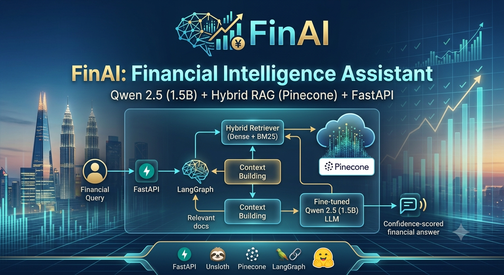
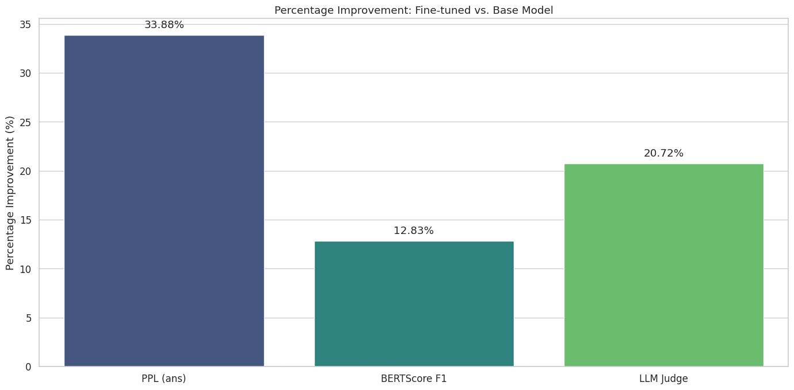
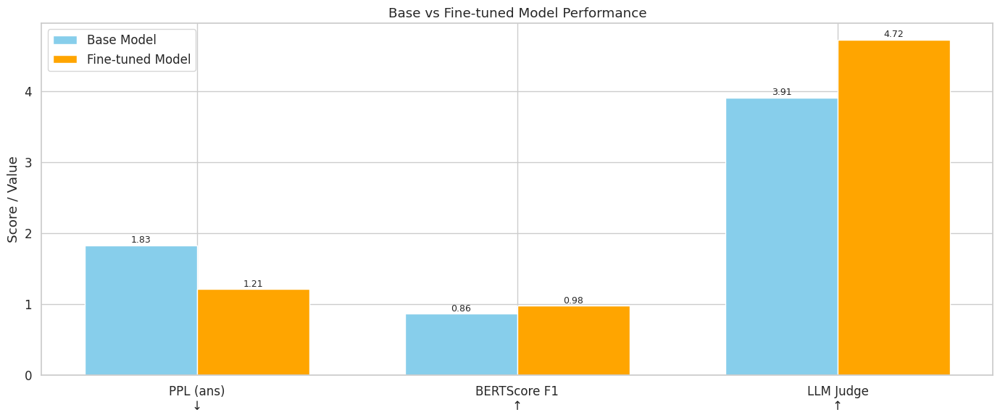
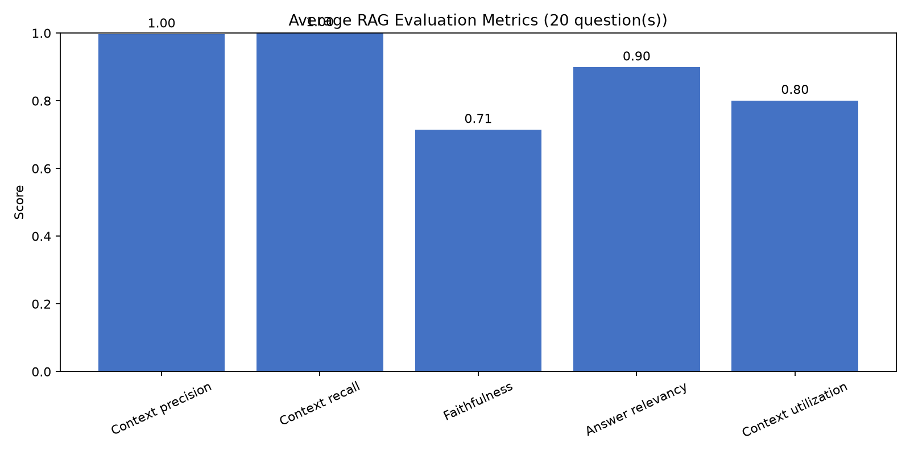
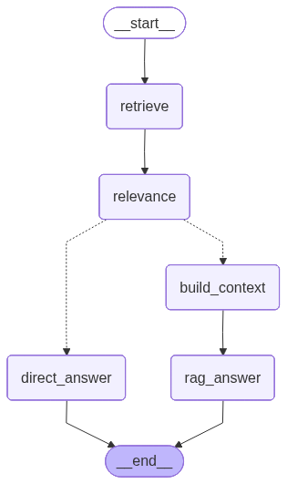

# FinAI — Financial Intelligence Assistant

A fine-tuned **Qwen2.5-1.5B-Instruct** model for financial question answering, served via a **FastAPI** backend with a **Hybrid RAG** pipeline powered by **Pinecone** and **LangGraph**.

---

## 📓 Training Notebook &nbsp;|&nbsp; 🎥 Demo

The notebook documents the fine-tuning, held-out language-model evaluation, and GGUF export.

**[Open the Qwen2.5-1.5B-Instruct fine-tuning notebook](https://huggingface.co/spaces/junaid17/FinAI/blob/main/Qwen2_5_1_5B_instruct_finance.ipynb)**

[](https://youtu.be/H0qx3JrcYv8)

---

## 🧠 Model Fine-Tuning

### Base model and data

| Dataset | Description |
|---|---|
| [`virattt/financial-qa-10K`](https://huggingface.co/datasets/virattt/financial-qa-10K) | Financial question-answer pairs with context |
| [`sweatSmile/FinanceQA`](https://huggingface.co/datasets/sweatSmile/FinanceQA) | Financial QA dataset (gated on Hugging Face) |

The notebook fine-tunes **[`Qwen/Qwen2.5-1.5B-Instruct`](https://huggingface.co/Qwen/Qwen2.5-1.5B-Instruct)** using a context-grouped train/evaluation/test split (seed 42) to keep identical contexts out of multiple splits. It reserves 500 examples for evaluation (the first 200 are used for in-training evaluation) and 200 for the held-out test set. Training and evaluation use the same chat template: a financial-assistant system message, a user turn containing context and question, and the answer as the completion.

### QLoRA configuration

| Setting | Notebook value |
|---|---|
| Base-model quantization | 4-bit NF4 with double quantization |
| Compute dtype | BF16 on supported GPUs; otherwise FP16 |
| LoRA rank / alpha / dropout | `r=64`, `lora_alpha=128`, `lora_dropout=0.05` |
| LoRA targets | `q_proj`, `k_proj`, `v_proj`, `o_proj`, `gate_proj`, `up_proj`, `down_proj` |
| Bias / task | `none` / causal language modeling |
| Optimizer / learning rate | `paged_adamw_8bit` / `2e-4` |
| Schedule / warmup | Cosine / 20 warmup steps |
| Batch / accumulation | Per-device batch 4 (BF16) or 2 (FP16), accumulated to 16 examples per device |
| Training limit | 1 epoch, capped at 250 steps |
| Regularization | Weight decay `0.01`; max gradient norm `0.3` |
| Evaluation/checkpointing | Eval every 50 steps; save every 100 steps; keep at most 2 checkpoints; select best by eval loss |
| Other settings | `SFTTrainer`; gradient checkpointing; completion-only loss; no packing; output adapter: `qwen2.5-1.5b-instruct-finance-qlora-sft` |

---

## 📊 Evaluation

### Fine-tuned language-model evaluation

The notebook compares the base and fine-tuned models on the held-out test data. Perplexity and BERTScore use 200 test examples; the LLM judge scores 100 examples. Lower perplexity is better; higher BERTScore and judge scores are better.

| Metric | Base model | Fine-tuned model | Change |
|---|---:|---:|---:|
| Answer perplexity ↓ | 1.90 | 1.38 | 27.4% lower |
| BERTScore F1 ↑ | 0.9178 | 0.9596 | 4.6% higher |
| LLM judge ↑ | 3.75 | 4.58 | 22.1% higher |

The judge is `openai/gpt-oss-120b` through Groq. It grades correctness and helpfulness independently on 1–5 scales; the table reports their average.





### RAG pipeline evaluation

The RAG evaluation runs the fine-tuned Qwen model against the 20 question-answer pairs in [`finance_rag_20_question_answer.pdf`](finance_rag_20_question_answer.pdf). The same PDF is loaded as the retrieval corpus. The evaluator uses the existing `RagPipeline` document loader, splitter, BM25 and dense hybrid retrieval, then scores the generated answers with Ragas.

Ragas uses the OpenAI-compatible XKIRO endpoint with `mistralai/mistral-small-2603` and `XKIRO_API_KEY` from `.env` as its judge. Answer Relevancy uses the Ragas Hugging Face embedding model `BAAI/bge-small-en-v1.5`. The plotted scores are means over all 20 questions:

| Ragas metric | Mean score |
|---|---:|
| Context Precision | 0.9963 |
| Context Recall | 1.0000 |
| Faithfulness | 0.7142 |
| Answer Relevancy | 0.8987 |
| Context Utilization (context relevance) | 0.8000 |



> **Benchmark note:** the PDF contains the reference answers and is also the retrieval corpus, so these results measure this self-retrieval setup rather than a held-out document benchmark.

---

## 🏗️ System Architecture

### LangGraph Workflow

The backend uses **LangGraph** to orchestrate a stateful RAG pipeline with conditional routing:



**Flow:**
1. `retrieve` — Hybrid retrieval (Dense + BM25) from Pinecone
2. `relevance` — Checks if retrieved docs are meaningful (>50 chars)
3. **Conditional Route:**
   - If relevant docs found → `build_context` → `rag_prompt` → LLM
   - If no relevant docs → `direct_prompt` → LLM

---

## 🔌 FastAPI Backend

### Endpoints

| Method | Endpoint | Description |
|---|---|---|
| `GET` | `/` | Health check |
| `POST` | `/upload` | Upload a PDF document for RAG |
| `DELETE` | `/reset` | Delete all documents from the vector store |
| `POST` | `/chat/stream` | Streaming chat with SSE (Server-Sent Events) |

### `/chat/stream` — Streaming Response Format

The chat endpoint streams responses using **Server-Sent Events (SSE)**. Three event types are emitted:

```
data: {"type": "metadata", "used_rag": true, "sources": [...], "confidence": 0.9312, "thread_id": "..."}

data: {"type": "token", "content": "..."}

data: {"type": "done"}
```

**`confidence`** — A sigmoid-normalized score (0.0–1.0) from the cross-encoder reranker reflecting how relevant the top retrieved document is to the query. `0.0` when RAG is not used (direct LLM fallback).

### `/upload` — Document Ingestion Flow

```
PDF Upload → Delete old docs → Load → Split (1000 chars, 250 overlap)
          → Embed & store in Pinecone → Build BM25 index
```

---

## 🔍 RAG Pipeline

### Embedding Model — `BAAI/bge-base-en-v1.5`

Chosen for its excellent balance of **speed and retrieval quality**:
- Ranked highly on the [MTEB Leaderboard](https://huggingface.co/spaces/mteb/leaderboard) for retrieval tasks
- 768-dimensional embeddings — compact yet highly expressive
- Significantly faster inference than larger models (e.g., `bge-large`) with minimal quality trade-off
- Optimized for semantic similarity, making it ideal for financial document retrieval

### Vector Database — Pinecone

- **Serverless** index on AWS `us-east-1`
- Cosine similarity metric
- 768-dimensional vectors matching the embedding model

### Hybrid Retriever — Dense + BM25

Combines two complementary retrieval strategies:

| Retriever | Type | Strength |
|---|---|---|
| **Dense** (Pinecone) | Semantic / vector search | Understands meaning and context |
| **BM25** | Keyword / lexical search | Exact term matching, financial jargon |

Results are merged and deduplicated, giving the best of both worlds — semantic understanding and precise keyword matching critical for financial terminology.

### Cross-Encoder Re-ranker — `cross-encoder/ms-marco-MiniLM-L-6-v2`

After hybrid retrieval, all candidate documents are re-scored using a **Cross-Encoder** model before being passed to the LLM.

**Why Cross-Encoder over Bi-Encoder for re-ranking?**
Bi-encoders (like the embedding model) encode query and document independently — fast but less accurate. A cross-encoder processes the query and document **together**, enabling full attention across both, which produces much more accurate relevance scores.

**Model chosen: `cross-encoder/ms-marco-MiniLM-L-6-v2`**

| Property | Detail |
|---|---|
| Size | ~85 MB |
| Architecture | MiniLM-L6 (6-layer transformer) |
| Trained on | MS MARCO passage ranking dataset |
| Strength | High accuracy relevance scoring at very low latency |
| Why this model | Best accuracy-to-size ratio among MS MARCO cross-encoders; well under 1 GB; production-proven |

**Pipeline after retrieval:**
```
Hybrid Docs (Dense + BM25, deduplicated)
  → Cross-Encoder scores each (query, doc) pair
  → Sort by score descending
  → Keep top 6 docs
  → Sigmoid-normalize top score → confidence (0.0–1.0)
  → Pass to LLM context
```

### Confidence Score

The reranker's top relevance score is sigmoid-normalized to a **0.0–1.0 confidence value** and returned in every `/chat/stream` metadata event. This lets the frontend indicate how strongly the retrieved context supports the answer.

---

## 🚀 Getting Started

### Prerequisites
- Python 3.10+
- Pinecone account
- `llama-cpp-python` installed (with appropriate backend for your hardware)

### Installation

```bash
git clone https://github.com/junaidariie/FinAI.git
cd FinAI
pip install -r requirements.txt
```

### Environment Variables

Create a `.env` file:

```env
PINECONE_API_KEY=<your_pinecone_api_key>
```

### Run the Server

```bash
uvicorn app:app --reload
```

API will be live at `http://localhost:8000`

---

## 🗂️ Project Structure

```
FinAI/
├── assets/
│   ├── improvements.png
│   ├── metrices.png
│   ├── rag_metrics.png
│   └── workflow.png
├── scripts/
│   ├── load_llm.py
│   ├── main.py
│   └── rag.py
├── Notebook/
│   └── Qwen2_5_1_5B_instruct_finance.ipynb
├── rag evaluations/
│   ├── README.md
│   ├── evaluate_rag.py
│   ├── plot_results.py
│   ├── results.csv
│   └── metrics.png
├── finance_rag_20_question_answer.pdf
├── app.py                  # FastAPI application
├── requirements.txt
└── .env
```

---

## 🤗 Model on Hugging Face

The fine-tuned GGUF model used by `scripts/load_llm.py` is hosted on Hugging Face:

**[junaid17/qwen2.5-1.5b-instruct-finance-assistant-gguf](https://huggingface.co/junaid17/qwen2.5-1.5b-instruct-finance-assistant-gguf)**

---

## 🛠️ Tech Stack

| Component | Technology |
|---|---|
| LLM | Qwen2.5-1.5B-Instruct (QLoRA fine-tuned, GGUF) |
| Inference | `llama-cpp-python` via `ChatLlamaCpp` |
| Fine-tuning | Hugging Face Transformers + PEFT + TRL (QLoRA) |
| Orchestration | LangGraph |
| Vector DB | Pinecone (Serverless) |
| Embeddings | `BAAI/bge-base-en-v1.5` |
| Sparse Retrieval | BM25 (`rank-bm25`) |
| Re-ranking | Cross-Encoder (`ms-marco-MiniLM-L-6-v2`) |
| RAG evaluation | Ragas + XKIRO `mistralai/mistral-small-2603` |
| Backend | FastAPI + Uvicorn |
| Memory | LangGraph `MemorySaver` (per thread_id) |
